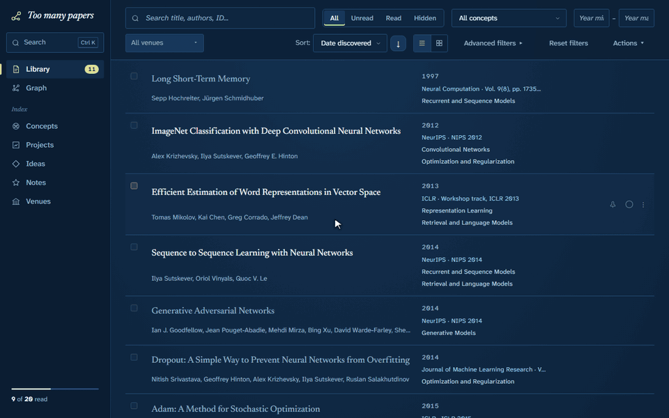

# Too Many Papers

A paper library for Claude that remembers why each paper matters to each of your projects.

You talk about papers; Claude adds them with verified metadata, fetches the PDF and wires up citations. When a paper is relevant to something you are working on, Claude reads it and writes a short analysis for that project: the findings that matter, where they are in the paper, and what it does not cover. When the project or the paper changes, the analysis is flagged as stale so it gets refreshed instead of quietly going out of date. Everything is plain JSON on your disk.

<p align="center">
  
</p>

## Install

**Claude Code / Claude Desktop**

```
/plugin marketplace add FrancescoCorrenti/TooManyPapers
/plugin install too-many-papers@too-many-papers
```

Restart Claude after installing. This repo is both the plugin and its marketplace.

**Cowork:** Customize > Plugins > Add > Add from repository, paste `https://github.com/FrancescoCorrenti/TooManyPapers`, sync, add **too-many-papers**, restart Claude.

**Cursor:** only the MCP tools (no skill, no slash command). Add to `~/.cursor/mcp.json`, with the path to your clone:

```json
{
  "mcpServers": {
    "too-many-papers": {
      "command": "uv",
      "args": ["run", "--directory", "/absolute/path/to/too-many-papers-plugin/server", "_scripts/mcp_server.py"]
    }
  }
}
```

**Requirements**

- [uv](https://docs.astral.sh/uv/) runs the MCP server.
  macOS/Linux: `curl -LsSf https://astral.sh/uv/install.sh | sh`
  Windows: `powershell -ExecutionPolicy ByPass -c "irm https://astral.sh/uv/install.ps1 | iex"`
- Node.js 18+, only for the web UI.

**Update:** `/plugin marketplace update`, then `/plugin update too-many-papers@too-many-papers`.

## How it works

| Piece | What it is |
|-------|-----------|
| **Paper** | A bibliographic record taken from a source read in the session (arXiv, Semantic Scholar, OpenAlex, Crossref). `source_verified` is mandatory and author lists are complete, never "et al.". The open-access PDF is fetched on add (arXiv, Semantic Scholar, Unpaywall, PMC, OpenAlex) and citations are linked to the papers you already have. |
| **Concept** | A research area you follow. Concepts tag papers and seed discovery. |
| **Project** | Something you are working on. Projects connect only to papers, and only through an analysis. |
| **Idea** | The analysis of one paper for one project: why it is relevant, the relevant findings, evidence with section or page references, limitations. Two projects that share a paper each get their own. |
| **Note** | A passage you selected in the PDF reader, with your comment. |

An analysis is written only after the paper has been read. It records what the project and the paper looked like at that moment; if either changes later (new project goal, corrected abstract, new source), the analysis is marked **stale** and shows up in the review queue. Linking the same pair again refreshes the same idea and keeps its history. Time passing never makes an analysis stale, and the plugin never plans your project for you.

On first use Claude asks what you are working on and drafts a starting set of concepts and projects for you to confirm.

## Things to ask

- "Add this paper: https://arxiv.org/abs/1706.03762"
- "Find recent work on retrieval-augmented generation for scientific text"
- "Is the LoRA paper useful for my RAG project?"
- "What do I have for the segmentation project, and what is it missing?"
- "Which analyses are out of date?"
- "Export the papers on diffusion as BibTeX"

## Web UI

Run `/too-many-papers:webui` or ask Claude to open Too Many Papers; it serves http://localhost:3737.

- **Library** with search, filters (concept, year, venue, linked to) and read/unread tracking.
- **PDF reader** inline in each paper: select text to save it as a note on that page.
- **Graph** of papers, concepts, projects, ideas and notes, clustered by topic, with an optional layer of cited papers you do not have yet. Clicking a node opens its detail in a drawer beside the graph; one button widens it, Esc closes it.
- Tabs for **Concepts, Projects, Ideas, Notes, Venues**, a Ctrl+K palette to jump anywhere, and a pencil on every item to edit it.
- One-click **BibTeX** export with stable cite keys.

## Data and privacy

Everything lives in `~/.too-many-papers`: `_papers.json`, `_graph.json`, `_venues.json`, a `pdfs/` folder and a `_log.jsonl` audit log. No account, no database, no cloud copy of your library; the server only goes online to query the paper sources above. Back up by copying the folder. Set `TOO_MANY_PAPERS_DATA_DIR` to use a different directory (both the MCP server and the web UI honour it).

Optional environment variables raise rate limits for discovery and PDF fetching:

| Variable | Purpose |
|----------|---------|
| `S2_API_KEY` | [Semantic Scholar](https://www.semanticscholar.org/product/api#api-key-form) API key |
| `OPENALEX_API_KEY` | [OpenAlex](https://openalex.org/settings/api) API key |
| `UNPAYWALL_EMAIL` | Contact email for Unpaywall PDF lookups |
| `TOO_MANY_PAPERS_CONTACT_EMAIL` | Fallback contact email for the above |

## Development

```sh
python -m unittest discover -s too-many-papers-plugin/server/tests -v
uv run --directory too-many-papers-plugin/server python tests/mcp_smoke.py
```

Add `--browser` to the smoke test to launch the web UI through MCP on isolated synthetic data. Changes go under **Unreleased** in [CHANGELOG.md](CHANGELOG.md); `python scripts/release.py X.Y.Z` cuts a release.

## License

MIT
